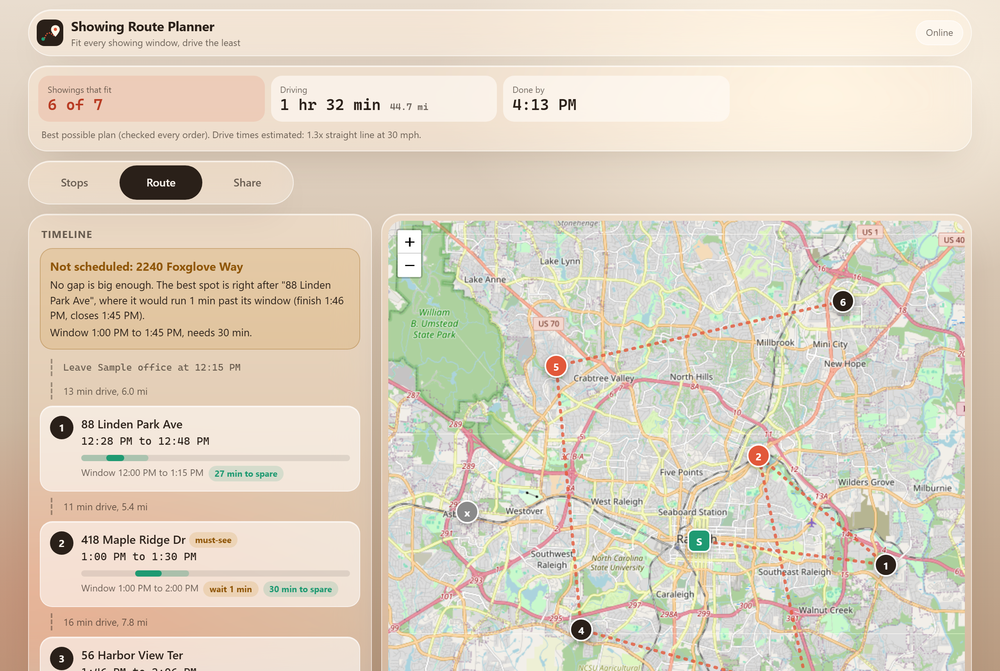

# showing-route-planner

[](https://github.com/chasebuilds/showing-route-planner/actions/workflows/ci.yml)

**What it is:** a phone-friendly web app that puts a day of home showings in the order that fits every listing agent's window with the least driving, and tells you which showings cannot work and why. Enter the homes (or import a CSV), the window for each, the minutes you need inside, and which are must-sees. Get a map, a timeline, and a buyer itinerary (print, calendar file, share text).

**Live demo:** https://chasebuilds.github.io/showing-route-planner/ (invented homes; installs to a home screen; works offline after the first load)

**Measured:** on 120 small days (6 to 10 stops) the planner's heuristic matched the exact optimum 120 of 120 times, and on 300 more it had never seen, 300 of 300. On 120 big days (12 to 30 stops) it was as good as or better than a nearest-neighbor route every time and drove 10.6% less when both served the same showings. Method and tables: [BENCHMARK.md](BENCHMARK.md).



## What you get

- **An order that fits the windows.** Waiting for a window to open is allowed. A showing that cannot finish before its window closes is left out.
- **Must-sees first.** The plan misses as few must-sees as possible, then as few showings as possible, then drives the least.
- **Plain reasons for what does not fit.** For example: "The best spot is right after 88 Linden Park Ave, where it would run 1 min past its window." Or: "Even driving straight from the start you would arrive at 1:30 PM."
- **Map and timeline.** Numbered pins on OpenStreetMap and a timeline with drive time, arrival, wait and minutes to spare for each showing. Drag the start pin, or tap the map to drop a new one. The route line is labeled on the map: straight lines by default, road lines when you use your own OSRM server.
- **CSV in and out.** Paste a day's list from a spreadsheet, or export what you built.
- **Buyer itinerary.** Print it (or save as PDF), download a `.ics` file for any calendar app, or share the text.
- **Works offline after the first load.** The app and the map tiles you have looked at are cached. Your data stays on your device.

## CSV import and export

Open "Import or export a CSV" on the Stops tab. The first row must be a header. Names are not case or spacing sensitive and column order does not matter.

| Column | Also accepted | Notes |
| --- | --- | --- |
| `label` | address, name, home, property, listing | Required. |
| `lat`, `lng` | latitude, lon, long, longitude | Decimal point or comma. Or use one `location` column like `35.81, -78.61`. |
| `open`, `close` | window_start, window_end, from, until | `1:00 PM`, `1pm`, `13:00`, `1300`. With no am or pm, 1 to 6 means afternoon and 7 to 11 means morning. |
| `window` | times, showing_window | Instead of open and close: `1:00-2:00 PM`, `1pm to 2pm`. |
| `minutes` | duration, mins | `30`, `45 min`, `1 hr`. Blank means 30. Allowed 5 to 240. |
| `must` | must_see, priority, required | `yes`, `true`, `1`, `x`, `high` mean must-see. Anything else means no. |

Commas, semicolons or tabs can separate columns, quoted cells may contain commas and line breaks, and a leading byte-order mark is fine. Rows that cannot be read are skipped and listed on screen with the row number and the reason, and the good rows still load. Rows with a label and a window but no coordinates are skipped unless you turn on address lookup (below). Export writes the same columns, and defuses labels that start with `=`, `+`, `-` or `@` so a spreadsheet does not run them as formulas (the import removes that mark again). "Template" downloads a two-row example.

## Travel times

By default the app does not call any server. It estimates drive time as straight-line miles x a road factor (default 1.3), driven at a flat speed (default 30 mph), rounded up to whole minutes. Both numbers are on screen and editable under "Travel time settings", so you can match your market.

For real drive times, switch on "Use my own OSRM server" and enter your server's address. The app asks its `/table` service for the drive-time matrix and its `/route` service for the road geometry, and draws the route along the roads. It is off by default and no server address is built in, so nothing is sent anywhere unless you set one. If the server fails, the app says so and falls back to the estimate and straight lines. The server must allow requests from the page (CORS), and an `http://` server will not work from the `https://` demo page, so use `https://` or run the app locally.

## Address lookup (optional geocoding)

Off by default. Under "Travel time settings", switch on "Look up addresses with my own geocoder" and enter the address of a geocoding service you are allowed to use. Then the stop form gets a Look up button that fills in coordinates from the label, and CSV rows with no coordinates are looked up on import, one request per second.

- No geocoding service is built into the code, and none is called unless you turn this on.
- The address text is sent to the server you entered. Do not use a service you would not trust with your clients' addresses.
- Public geocoding services have usage policies. Typical limits are about one request per second, no bulk or repeated lookups, no autocomplete-as-you-type, and attribution. The public OpenStreetMap Nominatim server, for example, publishes a policy like this. Read the policy of whatever you point the app at and follow it, or run your own instance.
- The endpoint can be a plain address (the app adds `?q=<address>&format=jsonv2&limit=1`) or contain `{q}` where the address goes. Answers shaped like Nominatim (a list with `lat` and `lon`) or GeoJSON (Photon, Pelias) work.

## How the planner works

One car, one day, no return to the start. Each showing has a window and a duration.

- **Up to 10 showings:** exact search. Branch and bound over every ordered subset, so the answer is the true best for the travel times given.
- **More than 10:** a heuristic. Cheapest-insertion starts, local search (or-opt runs of up to 6, 2-opt, swaps, adding or swapping in dropped stops), then rounds of removing a few stops and reinserting them, with an occasional rebuild from scratch in random order. It is seeded, so the same input always gives the same plan.
- **Order of goals:** fewest must-sees missed, then fewest showings missed, then least driving.

## Run it

```sh
npm install
npm test           # solver, infeasible windows, CSV, geocoding, OSRM, .ics output
npm run lint
npm run build      # copies the static site to dist/
npm run serve      # serves this folder at http://localhost:47831
npm run bench      # rewrites BENCHMARK.md
```

No bundler and no runtime dependencies: plain ES modules, with Leaflet 1.9.4 included under `vendor/`. `npm run screenshot`, `npm run smoke` (a browser check of CSV, OSRM and geocoding against mock servers) and `npm run icons` use Playwright if you have it installed.

## Limits

- The estimate does not know about traffic or one-way streets. Your own OSRM server gives road times, still without live traffic.
- One vehicle, one day, and the route ends at the last showing.
- Above 10 stops the answer is not proven optimal (see BENCHMARK.md for how close it gets).
- Map tiles come from OpenStreetMap and need a connection the first time you view an area.

## License

MIT. Leaflet is BSD-2-Clause, see `vendor/leaflet/LICENSE`. Map data (c) OpenStreetMap contributors.

## More from Chase Builds

- **[listing-kit](https://github.com/chasebuilds/listing-kit)**: One file becomes a listing website with gallery, map and flyer, plus a fair-housing wording checker. ([live demo](https://chasebuilds.github.io/listing-kit/))
- **[listing-data-normalizer](https://github.com/chasebuilds/listing-data-normalizer)**: Turns messy MLS and county exports into one clean table, with duplicates merged and price history kept. ([live demo](https://chasebuilds.github.io/listing-data-normalizer/))
- **[seller-net-sheet-cma](https://github.com/chasebuilds/seller-net-sheet-cma)**: Seller net sheet, buyer cash to close and a CMA presentation in one page. 20,000 of 20,000 prorations correct to the cent. ([live demo](https://chasebuilds.github.io/seller-net-sheet-cma/))

[All projects, sorted by industry](https://github.com/chasebuilds) · [chasebuilds.github.io](https://chasebuilds.github.io)
